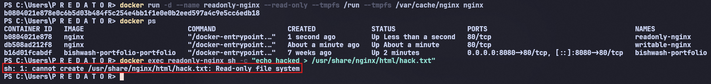
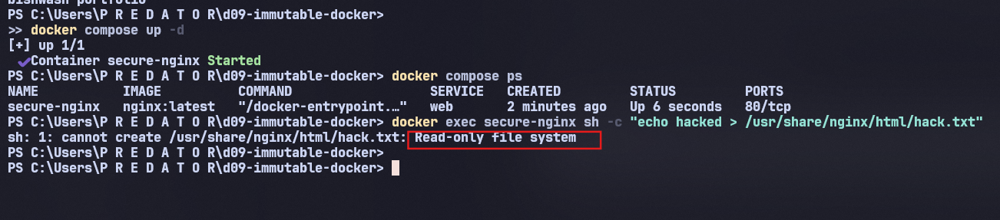

# D09 – Follow the Immutable Paradigm

OWASP Docker Top 10 demo by [Your Name].

## Idea

A container can be locked so its files cannot be changed while it runs.
If an attacker breaks into the app, they cannot plant or modify files.
To change the app, build a new image and replace the container.

## What this repo shows

| Demo | Setup | Result |
|------|-------|--------|
| 1 | Normal container | File creation succeeds |
| 2 | `--read-only` container | File creation fails (Read-only file system) |
| 3 | Docker Compose with `read_only: true` | File creation fails |

## How to run

See [commands.md](commands.md). Compose file: [compose.yaml](compose.yaml).

## Screenshots

### Demo 1: writable container

### Demo 2: read-only container

### Demo 3: Docker Compose

## Key points

- `--read-only` / `read_only: true` locks the root filesystem.
- `tmpfs` gives temporary writable memory space where an app needs it.
- Persistent data belongs in volumes.
- Rebuild and redeploy instead of editing running containers.

## References

- https://owasp.org/www-project-docker-top-10/
- https://docs.docker.com/reference/cli/docker/container/run/
- https://docs.docker.com/reference/compose-file/services/
- https://docs.docker.com/engine/storage/tmpfs/